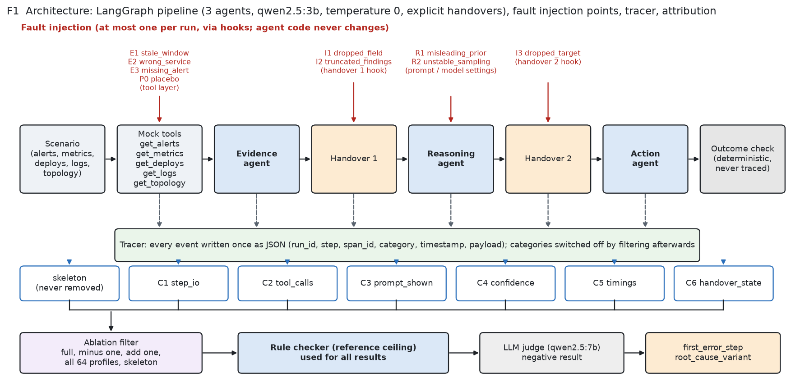

# log-ablation

[](https://github.com/rakeshreddy3466/log-ablation/actions/workflows/ci.yml)

**Which log line would have told me? A logging ablation on a three-agent LLM pipeline.**

A seeded online-shop incident-triage pipeline (evidence agent, reasoning agent, action agent, with
explicit handovers) runs 375 times. Eight single faults and a placebo are injected, every run is
logged in six categories, and the categories are then removed again to measure which ones let you
attribute the first error and its mechanism, and what each costs in bytes, write time and
sensitive content.

**Headline.** Two categories carry almost all of the value: tool calls (C2) and the prompt shown
(C3), plus a handover record (C6) for interface faults. The frozen minimum profile
**C2 (masked) + C3 (light: template hash and options) + C6** keeps attribution at full-logging
accuracy (100% on 27 held-back manifested runs, 97.7% on 44 masked runs) at 39% of the bytes and
about a tenth of the planted sensitive values. An LLM judge (qwen2.5:7b) did not beat chance and is
reported as a negative result; a deterministic rule checker is the attribution method.



## Results

| | |
|---|---|
| Runs | 375 (100 clean, 245 faulted, 30 placebo); 93 manifested, 152 masked |
| Placebo flip rate | 20% (6/30, 95% CI 6.7-35.7%) |
| Clearly above placebo | R1 71%, E2 63%, I2 61%, E3 43% (E1, R2, I1, I3 are not) |
| Full logging (design, rule checker) | 92.4% first error, 92.4% root cause |
| Value | minus C2: -37.9 points; minus C3: -15.2 / -18.2; C1, C4, C5, C6 alone: no measurable value |
| Size (median per run) | full 46.9 kB; C3 17.2 kB; C2 12.9 kB; frozen profile 18.3 kB (39%) |
| Write overhead | 0.5 ms per run with everything on (0.002% of a 29.5 s run) |
| Presidio vs planted values | IP, API key, order id 100%; **e-mail 0%** (`.test` domain); overall 77.6% |
| Frozen profile on the holdout | 100% / 100% (manifested), 97.7% / 97.7% (masked); full is the same |
| LLM judge (dev set) | root cause 12.5-18.8% vs 12.5% chance: failed |

Figures: [F1 architecture](figures/F1_architecture.png) |
[F2 fault map](figures/F2_fault_map.png) |
[F3 manifested vs masked](figures/F3_manifested_vs_masked.png) |
[F4 ablation drops](figures/F4_ablation_drops.png) |
[F5 value vs cost](figures/F5_value_vs_cost.png) |
[F6 category x variant](figures/F6_category_variant_heatmap.png) |
[F7 profile frontier](figures/F7_profile_frontier.png) |
[F8 confusion matrices](figures/F8_confusion_matrices.png) |
[F9 holdout](figures/F9_holdout.png). Tables T1-T5: [results/tables](results/tables).
Full write-up: **[REPORT.md](REPORT.md)**.

## Reproduce

```
uv sync                      # Python 3.12; installs Presidio and the spaCy en_core_web_sm model
make test && make lint
make report                  # every figure and table from the committed results/ (no models)
```

Rebuilding the data from scratch (needs [Ollama](https://ollama.com) with `qwen2.5:3b`):

```
make scenarios               # 300 seeded scenarios (data/scenarios is git-ignored)
make run                     # 100 clean + planned faulted runs, resumable, several hours
make attribute               # split + rule-based 64-profile ablation (design side)
make analyse                 # dataset results, costs and privacy, minimum profile
make holdout                 # only after results/profile.json is committed
make report
```

Run records and traces contain planted fake e-mails, IPs, API keys (`synth_key_...`) and order ids
and are never committed (`runs/` is git-ignored); only aggregates and figures are.

**Hardware notes.** Developed on a MacBook Pro M2 with 8 GB. `qwen2.5:3b` needs about 2.5 GB
(100% GPU, about 39 tokens/s); the judge (`qwen2.5:7b`) runs alone after the agents. Every request
passes `num_ctx=8192` (a default 131072 context once made a 3B model take 23 GB and hang the Mac);
only one model is loaded at a time, checked by `agents.guard` before and after every run.

## Limitations (brief)

Synthetic scenarios and a single 3B model; small samples (27 holdout manifested runs; only 1 manifested
design run for I3); the rule checker was written knowing the faults, so its numbers are a ceiling;
one 70/30 split; Presidio misses the planted `.test` e-mails; one placebo position. Details in
[REPORT.md](REPORT.md).
